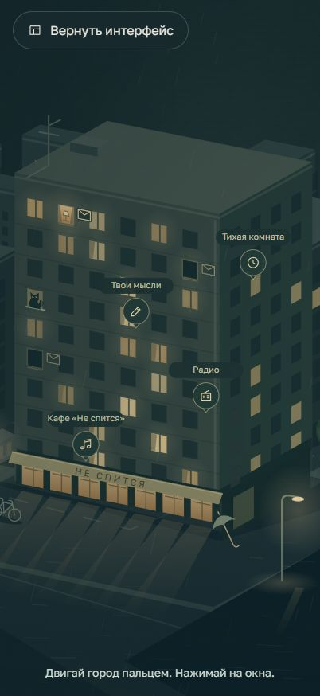
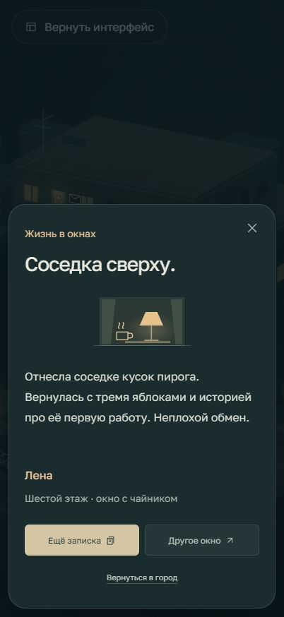
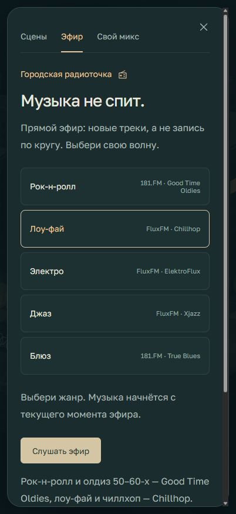

# After Rain

**The city falls asleep. You exhale.**

A small nighttime city in your browser. Warm windows, a café that's still open,
rain on the rooftops. Build a soundscape, find some music, and take a moment
without having to get anything done.

**[Enter the city](https://city.maark.ru/)** · [Русский](README.md) / **English** · [Suggest an idea](https://github.com/MerlinRus/SilentCity/issues)

> Not another to-do list. Somewhere to put it down for a while.

## Make this evening your own

| If you feel like… | There's a place for that |
| --- | --- |
| Taking a break from the noise | **30 sounds to mix:** rain, a fireplace, thunder, the sea, forest birds, crickets, a purring cat and the Saint Petersburg metro. Each has its own volume. |
| Finding the right music | **Five live radio genres:** rock'n'roll and oldies, lo-fi, electronic, jazz and blues. Real broadcasts, not short recordings on repeat. |
| Knowing someone else is still awake | **Life in the windows:** 36 little notes from Lena, Misha and Sonya. Read another from the same neighbour or visit a different window. |
| Clearing your head | **“Your thoughts”** — a private browser notebook, without publishing anything. |
| Focusing on just one thing | **“The quiet room”** — a 25-minute timer. |
| Looking around | **“Explore the city”** — the controls fade away and the city moves closer. On a phone, drag to wander around. |

There's also a cat, an occasional tram, a bicycle outside the café,
and a paper boat in a puddle. You don't need to find everything at once.

## A closer look

<table>
  <tr>
    <td align="center"></td>
    <td align="center"></td>
    <td align="center"></td>
  </tr>
  <tr>
    <td align="center">Take your time</td>
    <td align="center">Still awake?</td>
    <td align="center">Find your frequency</td>
  </tr>
</table>

Actual screenshots, not mockups. **The app interface is currently in Russian.**
This English page is a guide to the project, not an English UI.

## Your first visit

1. [Open the city](https://city.maark.ru/). No installation or account needed.
2. Press **“Побыть здесь”** (Stay a while) or the play button. Sound only starts after you choose to play it.
3. Open **“Свой микс”** (Your mix), find **“Радио”** (Radio) on the building, or tap a window with an envelope.

Try **a fireplace + rain**, **lo-fi + a café**, or just **the metro**.
Headphones and a gentle volume work nicely.

On desktop: **M** toggles sound, **F** toggles fullscreen, and **Esc** closes a panel or leaves exploration mode.

## A little breathing room

- Your notebook, sound settings and reading history stay **in your browser**. No account or cross-device sync. Clearing site data removes them.
- The city, illustrations and icons are drawn **in SVG**. There is a mobile layout and support for your system's reduced-motion preference.
- Audio loads when you enable a sound. Browsing the catalogue does not download all 30 recordings.
- Live radio needs an internet connection and connects to external stations. Their broadcasts may include adverts, jingles or interruptions.

## Help make the city cosier

Have an idea for a small detail, found something awkward, or want another sound?
[Open an issue](https://github.com/MerlinRus/SilentCity/issues).
For bugs, include your browser, device and what happened — not your private notes or other personal data.

Created by [MerlinRus](https://github.com/MerlinRus).
If you enjoyed your stay, a repository star or [sharing the city with a friend](https://city.maark.ru/) is always welcome.

## Behind the windows

[Run locally and developer notes, in Russian](DEVELOPMENT.md) · [Sound credits](sounds/SOURCES.md) · [Radio stations and sources](RADIO.md)

The 30 ambient recordings have individual credits and CC0 licences. These do not
cover music broadcast by the external radio stations. A separate source-code
licence has not been added yet.

---

**A small place. Just for you.**
